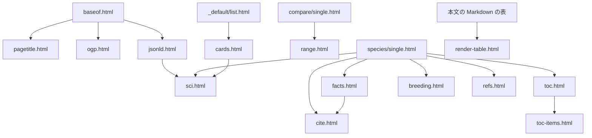
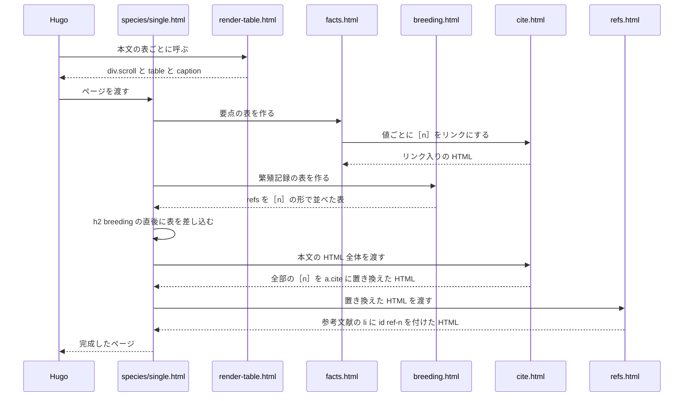
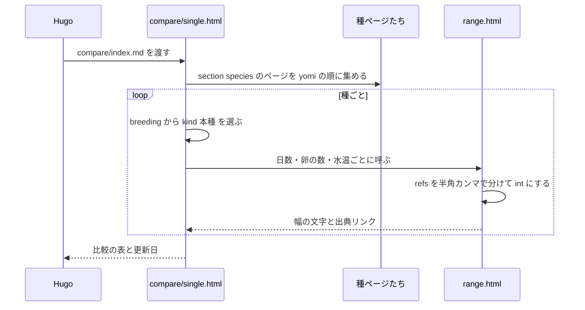
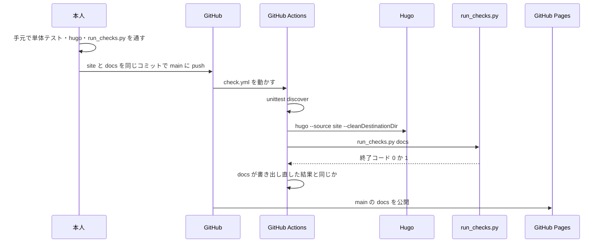

# 構成（architecture）

## Architecture Analysis

### System Overview

サーバーを持たない「静的サイト」です。本人が Markdown の原稿を書き、Hugo（原稿とテンプレートから HTML を作る道具）で `docs/` に書き出し、GitHub Pages がその `docs/` をそのまま公開します。データベースも、外部のサービスを呼ぶ処理もありません。

その横に、書き出した結果を調べる Python の「確認のプログラム」（`tools/check/`）があり、手元と GitHub Actions の両方で動きます。

### Architectural Style

**ひとまとまりの静的サイト（モノリス）＋書き出し後の確認**です。根拠:

- 動く部分は「書き出しのとき」だけで、公開中に動くプログラムはありません（`site/hugo.toml` の `publishDir = "../docs"`）。
- 画面の共通部分は `baseof.html` 1 つにまとめ、ページの種類ごとのテンプレート（`species/single.html`、`compare/single.html` など）が中身を差し込みます（`team.md` の `## Code Style` の方針）。
- 品質は、テンプレートを直接テストするのではなく、書き出した HTML を調べて確かめます（`tools/check/`）。

### Component Relationships

```mermaid
flowchart LR
  subgraph SRC["site/ の原稿と設定"]
    CFG["hugo.toml"]
    DATA["data/facts.toml"]
    ARC["archetypes/species.md"]
    CON["content/ の原稿"]
  end
  subgraph TPL["site/layouts/ のテンプレート"]
    BASE["_default/baseof.html"]
    SP["species/single.html"]
    CMP["compare/single.html"]
    UPD["updates/list.html"]
    LST["_default/list.html と single.html"]
    RT["_default/_markup/render-table.html"]
    PART["partials/ の部品"]
  end
  HUGO["Hugo 0.158.0"]
  DOCS["docs/ 書き出した結果"]
  CHK["tools/check/ 確認のプログラム"]
  CI["GitHub Actions check.yml"]
  PAGES["GitHub Pages"]
  CON --> HUGO
  CFG --> HUGO
  DATA --> HUGO
  TPL --> HUGO
  HUGO --> DOCS
  DOCS --> CHK
  CFG --> CHK
  DATA --> CHK
  CON --> CHK
  ARC --> CHK
  CI --> HUGO
  CI --> CHK
  DOCS --> PAGES
```

文字での説明: 原稿（`content/`）・設定（`hugo.toml`）・要点の表の項目（`data/facts.toml`）・テンプレート（`layouts/`）を Hugo が読み、`docs/` に書き出します。確認のプログラムは `docs/` と、`hugo.toml`・`facts.toml`・種の原稿・ひな形（`archetypes/species.md`）を読みます。GitHub Actions は Hugo と確認のプログラムを動かします。GitHub Pages は `docs/` を公開します。

テンプレートの中の部品の呼び出し関係:

文字での説明: `baseof.html` → `pagetitle.html`・`ogp.html`・（種ページだけ）`jsonld.html`。`jsonld.html` → `sci.html`。`species/single.html` → `sci.html`・`facts.html`・`toc.html`（→ `toc-items.html`）・`breeding.html`・`cite.html`・`refs.html`。`facts.html` → `cite.html`。`compare/single.html` → `range.html`。`_default/list.html` → `cards.html` → `sci.html`。本文の Markdown の表は、すべて `render-table.html` で書き出されます。

### Data Flow

1. 原稿のフロントマター（TOML）に、ページの情報（`title`、`yomi`、`scientific`、`date`、`lastmod`）、要点の表の値（`[facts]`）、繁殖記録（`[[breeding]]`）を書きます。
2. Hugo が本文の Markdown を HTML にします。表は `render-table.html`、見出しの `{#id}` と表の下の `{caption="…"}` は Goldmark の属性の機能で読みます。
3. 種ページのテンプレートは、できた本文の HTML を **文字列として** 加工します: 「4. 繁殖記録の比較」の見出しの直後に繁殖記録の表を差し込み、本文全体の［n］をリンクに置き換え（`cite.html`）、参考文献の各項目に `id="ref-n"` を付けます（`refs.html`）。
4. 比較ページは、全種ページの `[[breeding]]` のうち `kind = "本種"` の記録から数字の幅を作り、出典番号を種ページの `#ref-n` へのリンクにします（`range.html`）。
5. 更新履歴は全ページの `lastmod` から並べます。
6. `docs/` に書き出し、確認のプログラムが `docs/` を読んで調べます。

### Key Design Decisions

| 決めたこと | 理由・効き目 | 気をつける点 |
|---|---|---|
| 要点の表の項目を `data/facts.toml` だけで決める | テンプレートと確認のプログラムが同じファイルを読むので、ずれない | 変えたら書き出しと確認をやり直す |
| 本文の HTML を文字列・正規表現で加工する（`species/single.html`、`cite.html`、`refs.html`） | 原稿の書き方を変えずに、出典リンクや表の差し込みができる | HTML の構造を知らずに置き換えるので、属性の中まで変わる（指摘1） |
| フロントマターを TOML にする | 確認のプログラムが Python の標準ライブラリ（`tomllib`）だけで読める | トップの `_index.md` だけ YAML |
| `panicOnWarning = true` | 警告を見落とさない | テンプレートのエラー（指摘4）でも書き出し全体が止まる |
| 確認は書き出した結果に対して行う | 読者が見る HTML そのものを確かめられる | テンプレートの不具合は、原稿にその形が出るまで見つからない |
| `--cleanDestinationDir` で `docs/` を空にしてから書き出す | 消したページが残らない | — |

### Improvement Opportunities

- 本文の HTML の文字列加工を、テキストの部分だけに効くようにする（属性を避ける）か、Markdown の段階で処理する（指摘1）。
- ［n］の形の決まり（正規表現）を 1 か所にまとめ、テンプレートと確認のプログラムでそろえる（指摘2）。章の名前と繁殖記録の列も、2 か所に書かれています（code-quality-assessment.md）。
- 比較ページのような「ほかのページから作るページ」の更新日を、元のページから自動で決める（指摘6）。

## Interaction Diagrams

### 種ページを書き出す流れ

文字での説明: Hugo は本文の表を `render-table.html` で書き出します（表の名前は `<caption>` と、枠の `aria-label` の 2 か所に入ります）。種ページのテンプレートは、要点の表（値ごとに `cite.html`）を作り、繁殖記録の表を「4. 繁殖記録の比較」の見出しの直後に差し込み、本文全体を `cite.html` に通して［n］をリンクにし、最後に `refs.html` で参考文献に `id="ref-n"` を付けます。`cite.html` は属性の値（`aria-label`）の中の［n］も置き換えてしまいます（指摘1）。

### 比較ページを書き出す流れ

文字での説明: 比較ページは全種ページを読みの順に集め、`kind = "本種"` の記録だけで日数・卵の数・水温の幅を作ります。`range.html` は refs を半角の `,` で分けて数にするので、「5、6」があると書き出しが止まります（指摘4）。表示する更新日は `compare/index.md` に手で書いた `lastmod` です（指摘6）。

### 確認と公開の流れ

文字での説明: 本人が手元で 3 つの確認を通し、`site/` と `docs/` を同じコミットにして `main` に push します。GitHub Actions は、単体テスト → Hugo の書き出し → `run_checks.py` → 「コミットした `docs/` と書き出し直した結果が同じか」の順に調べます。公開そのものは確認とは別で、GitHub Pages が `main` の `/docs` をそのまま公開します（確認が失敗しても公開は止まりません）。
