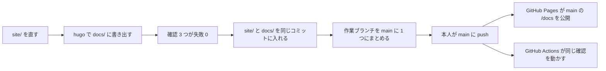

# 公開のしくみ（CD Configuration）

このサイトの公開は、新しい仕組みを作らず、いまの GitHub Pages の設定をそのまま使います。今回の作業で公開のしくみは変えていません。

## 流れ

文字だけで書くと、次の順です。

1. `site/` を直す
2. `hugo` で `docs/` に書き出す
3. 確認 3 つが失敗 0 件で通る
4. `site/` と `docs/` を同じコミットに入れる
5. 作業ブランチを `main` に 1 つにまとめる
6. 本人が `main` に push する
7. push のあと、GitHub Pages が `main` の `/docs` を公開し、GitHub Actions が同じ確認を動かす

## 設定

| 項目 | 値 | 置き場所 |
|---|---|---|
| 公開元 | `main` ブランチの `/docs` | GitHub のリポジトリ設定（Pages） |
| 公開先 | `https://moubosama.github.io/aqua-species-note/` | 同上 |
| 自動の確認 | push と pull request のたびに、単体テスト・`hugo` の書き出し・`run_checks.py`・`docs/` が `site/` と一致するか | `.github/workflows/check.yml` |
| Hugo の版 | 0.158.0（extended） | README、`check.yml` |
| 検索に載せない設定 | `[params.test] noindex = true` | `site/hugo.toml` |

## 公開の前の関門

- 手元で、確認 3 つ（`hugo`、`run_checks.py docs`、単体テスト）が失敗 0 件で通ること。
- 今回の作業では、さらに公開の前に、次のものを本人が原文で確かめること（project.md の決まり「AI が出した数字は公開の前に本人が原文で確かめる」）。
  - 確認の記録の「4. 確認済みにした繁殖記録」
  - 「相違 → 直した」の 12 件
