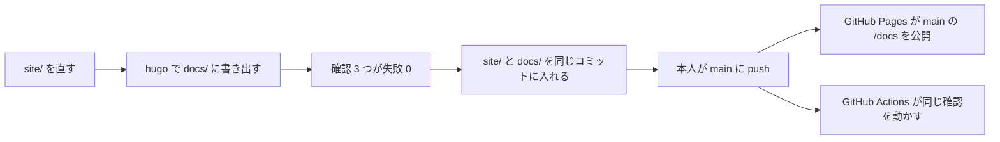

# 公開のしくみ（CD Configuration）

公開のしくみは前の作業から変わっていません。詳しくは `aidlc/spaces/default/intents/261116-verify-zebrina-sources/operation/deployment-pipeline/cd-config.md` を見てください。

## 流れ（変わらない）

文字だけで書いた流れ:

1. `site/` を直す
2. `hugo` で書き出す
3. 確認 3 つが失敗 0 件で通る
4. 同じコミットに入れる
5. 本人が push する
6. GitHub Pages が公開する。あわせて GitHub Actions が同じ確認を動かす

## 今回の作業で変わったこと

- **GitHub Actions の単体テストのステップ**: 新しいテスト `test_templates_hugo.py` も動きます。
  - このテストは、Hugo で、テスト用の原稿を一時フォルダに書き出して調べます。
  - Actions では、単体テストより前に Hugo を入れているので、このテストは飛ばされずに動きます。
- **公開の前の関門**: 確認 3 つのままです。いまは 94 件の単体テストと、7 種類の確認です。
- **気をつけること（前の段階で分かった点）**: GitHub Pages は、Actions の結果に関係なく `main` の `/docs` を公開します。そのため、push の前に、手元で確認 3 つが通っていることを必ず見てください。
